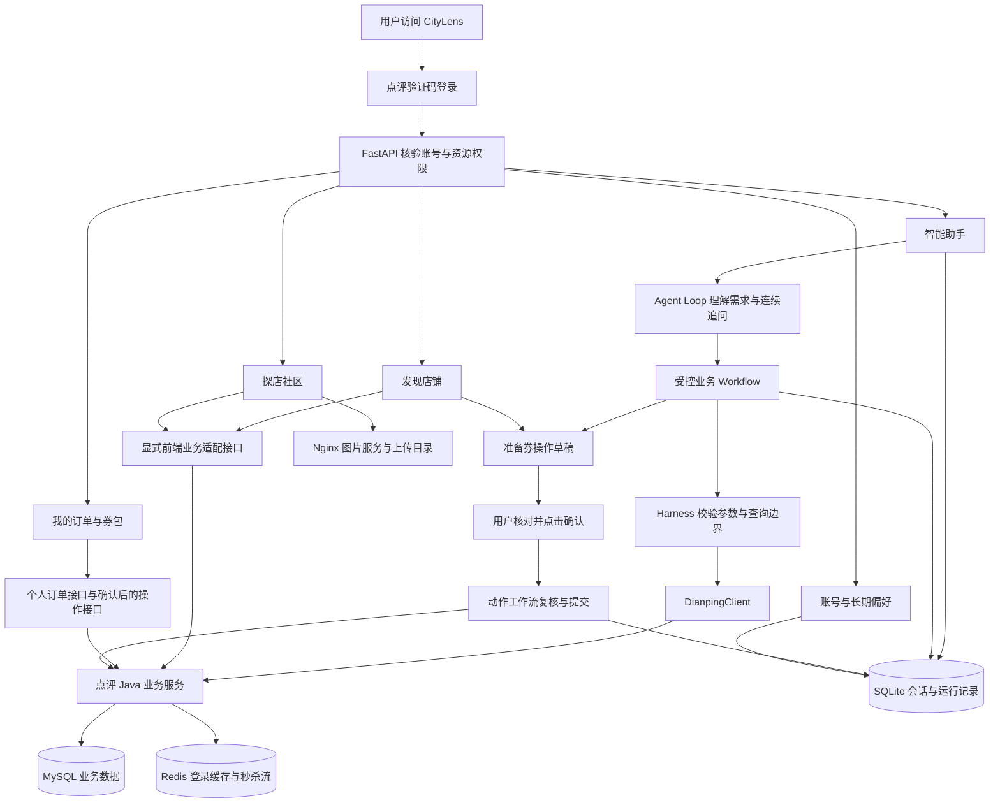
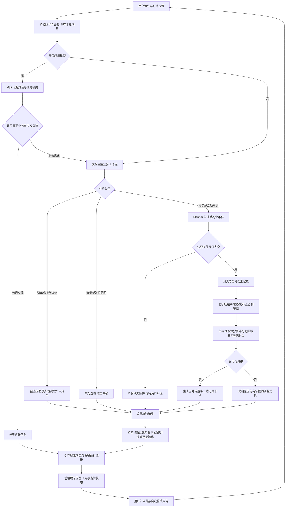
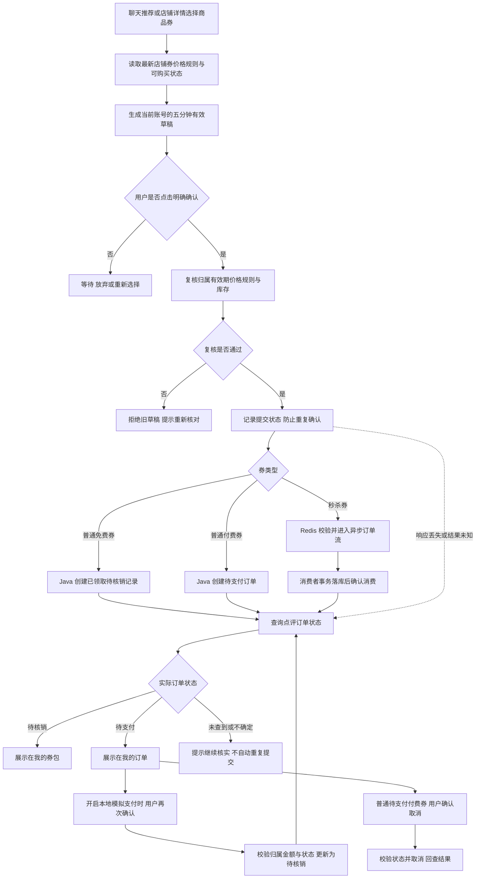

# CityLens

CityLens 是基于黑马点评业务数据的本地生活决策与消费助手。用户可以用自然语言找店、规划最多三站活动、连续调整条件，也可以直接浏览店铺和探店笔记，查看商品券、确认下单并管理个人订单与券包。

当前版本以本地演示为主。店铺事实来自点评服务，预算和直线距离由程序计算；下单、取消和模拟支付都需要用户明确确认。项目包含演示商品与合成笔记，没有接入真实支付、退款、核销或包厢预约。

产品需求见 [PRD](wiki/PRD.md)，用户操作与状态流转见 [业务流程说明](wiki/业务流程说明.md)，核心实现见 [核心代码讲解](wiki/核心代码讲解.md)，当前项目不足见 [项目不足](wiki/项目待改项目进点.md)，前端说明见 [frontend/README.md](frontend/README.md)，项目经历写法见 [技术简历](wiki/简历包装.md) 与 [产品简历](wiki/产品简历.md)。

## 目录

- [功能与边界](#功能与边界)
- [目录与架构](#目录与架构)
- [功能架构与整体流程](#功能架构与整体流程)
- [Agent 执行流程](#agent-执行流程)
- [环境与端口](#环境与端口)
- [首次启动](#首次启动)
- [登录与使用](#登录与使用)
- [日常启动停止与更新](#日常启动停止与更新)
- [配置说明](#配置说明)
- [前端开发](#前端开发)
- [数据初始化与备份](#数据初始化与备份)
- [测试与接口](#测试与接口)
- [常见问题](#常见问题)

## 功能与边界

| 模块 | 当前支持 | 主要限制 |
| --- | --- | --- |
| 智能助手 | 单站找店、最多三站规划、澄清、换店、修改预算与顺序、逐轮卡片 | 候选范围有限，不能保证全库最优；无道路路线或真实预约 |
| 会话 | 历史切换、删除、跨重启恢复、停止任务、运行回放 | 不是完整模型上下文或逐工具断点恢复 |
| 发现店铺 | 分类、关键词、评分/价格排序、分页、详情、商品券、关联笔记 | 店铺评价接口未接入 |
| 探店社区 | 热门/关注/我的笔记、详情、点赞、关注、图片上传与发布 | 无评论、社区关键词搜索和完整个人主页 |
| 商品与订单 | 商户商品查询、免费领取、付费券待支付订单、秒杀、状态回查、普通待支付订单取消 | 普通券无数量库存；秒杀提交与异步落库分开 |
| 我的券包 | 当前账号已领取/已支付、待核销的券 | 待支付订单不计入；不保证使用条件已核实 |
| 长期偏好 | 主动同意后保存、编辑、查看和删除 | 仅保存结构化偏好，不自动保存精确位置 |
| 模拟支付 | 本地订单由待支付变为待核销 | 不扣真实资金，Java 默认关闭，当前 Compose 明确开启 |
| 演示商品管理 | 授权账号新增普通、免费、秒杀券 | 默认不开放；白名单不等于真实商家权限体系 |

人均价格为参考值；多站估算不提前扣除未核实的券优惠；距离为直线距离；登记营业时间不代表实时营业；探店观点和合成数据都有各自限制。

## 目录与架构

本项目依赖同一上级目录下的点评工程和静态资源，不能只复制 CityLens 目录后直接使用默认 Compose。

```text
黑马点评/
├── CityLens/
│   ├── citylens/             # FastAPI、Agent、工作流与状态管理
│   ├── frontend/             # Vue 3 + TypeScript + Vite
│   ├── static/               # 旧版页面
│   ├── dev/                  # Docker Compose、Nginx、演示 SQL
│   ├── scripts/              # 评测、联调和 SQLite 备份
│   ├── tests/                # 自动化测试与固定任务集
│   ├── reports/              # 历史验证报告
│   ├── data/                 # 运行后生成的 SQLite 数据，不入 Git
│   ├── wiki/                 # PRD 与历史资料
│   ├── .env.example
│   └── requirements.txt
└── 点评/
    ├── hm-dianping/          # Java / Spring Boot、原始 SQL
    └── nginx-1.18.0/html/hmdp/ # 点评原页面与图片目录
```

```text
浏览器（8090，新版 Vue 页面）
  → CityLens / FastAPI（本机 Python）
      → Agent：理解与追问 → Workflow：查询与确定性校验
          → 点评 Java（Docker，8081）→ MySQL / Redis
      → 用户确认的券动作工作流 → 点评订单接口
      → SQLite：会话、消息、偏好、运行与动作记录
  → 点评 Nginx（Docker，8080）：图片、原页面与 Java 代理
```

Agent 负责理解需求与选择受控查询；Workflow 负责预算、价格、评分、身份和动作状态；Harness 限制工具权限、参数、资源与超时。模型没有直接支付或确认交易的工具。

## 功能架构与整体流程

### 1. 功能入口与服务分工

登录后，用户既可以通过助手表达需求，也可以从店铺和社区入口自主浏览。两类入口最终复用同一套商品预览、用户确认和订单状态查询规则。



图中表示业务职责与数据去向。浏览器的业务请求先经过 FastAPI；浏览器不直接连接 MySQL、Redis，也不接触 Java 登录令牌。图片通过 Nginx 读取，上传和发布仍经过登录与字段校验。

| 层级 | 主要模块 | 职责 |
| --- | --- | --- |
| 页面层 | Vue 聊天、店铺、社区、订单、券包与账号页面 | 展示数据、采集条件、提供明确确认入口 |
| API 与身份层 | `api.py`、`web_api.py` | 点评账号核验、资源归属、写操作来源检查、前端业务适配 |
| 对话层 | `dialogue.py`、`agent_loop.py`、`llm.py` | 普通交流、业务交接、读取工具结果后继续回复、供应商协议适配 |
| 业务层 | `planner.py`、`workflow.py`、`business.py` | 条件解析、澄清、单站/多站规划、个人资产查询与业务多轮状态 |
| 执行边界 | `harness.py`、`run_context.py`、`tools.py` | 工具白名单、参数校验、预算、超时、取消与事件记录 |
| 动作层 | `actions.py` | 券预览、确认前复核、提交幂等、未知结果回查和取消动作 |
| 点评服务层 | Java / Spring Boot | 店铺、笔记、商品与订单业务规则；模拟支付通过独立接口处理 |
| 数据层 | MySQL、Redis、SQLite、图片目录 | 分别保存业务数据、临时执行数据、助手状态与媒体文件 |

### 2. 智能助手从提问到推荐



模型可以选择补查工具，但最终门店事实、预算和硬条件由工作流核验。补查受候选范围和调用预算限制；多站方案在组合前复核候选。模型收尾失败时保留已核验的工作流结果。

追问继承已确认条件，只修改用户明确改变的部分。切换品类清除旧关键词与相对价格基准；普通交流不清空原业务任务。上游故障、用户取消和无匹配结果使用不同状态，不能都归为“没有店”。

### 3. 选券、下单与个人券包



草稿、订单和持有券是三个不同对象：预览不会下单，待支付订单不会进入券包。秒杀请求被接受不等于已落库；网络超时也不等于操作失败，应先查询状态。模拟支付不扣真实资金，模型不能调用支付写工具。

### 4. 浏览、社区与历史恢复

| 用户路径 | 整体流程 | 与助手的衔接 |
| --- | --- | --- |
| 自主找店 | 分类/关键词 → 排序分页 → 店铺详情 → 商品券或关联笔记 | 从明确门店转交助手分析；选券复用动作确认流程 |
| 探店阅读 | 热门/关注/我的笔记 → 笔记详情 → 关联店铺 | 笔记作为有来源的主观参考，不替代客观字段 |
| 内容发布 | 选择真实店铺 → 上传图片 → 填写图文 → 用户发布 → Java 保存 | 发布身份取自登录账号，模型不自动发布 |
| 个人资产 | 当前账号 → 查询订单或券包 → 展示状态 → 选择符合条件的操作 | “我的券”和“商家有哪些券”分别读取个人资产与商户商品 |
| 历史恢复 | 选择本人会话 → 读取服务端消息 → 恢复关联结果 → 继续追问 | 历史卡片是快照；新查询重新核验，旧确认不会自动提交 |
| 长期偏好 | 用户明确同意 → 保存结构化条件 → 新任务补缺省值 | 当前输入优先，使用时标明来源，可随时删除 |

### 5. 启动时的数据准备流程

首次部署时，MySQL 空数据卷按“原始点评 SQL → 演示证据 SQL → 演示商品 SQL”初始化；MySQL 和 Redis 健康检查通过后启动 Java。Nginx 提供图片与点评原页面，前端构建完成后由单独启动的 CityLens Python 服务提供统一首页。

**已有 MySQL 数据卷不会因重启再次执行初始化 SQL。** 数据补导入、前端构建和 Python 启动仍需按下面的步骤执行，不能把 `docker compose up -d` 理解为所有应用和数据更新均已完成。

## Agent 执行流程

下面按真实模块说明一条请求如何执行。当前采用顶层对话 Agent 加受控业务工作流，业务补查复用同一个 `AgentLoop` 内核；会话与偏好保存到 SQLite。Redis 用于点评侧登录、缓存和秒杀，不保存 CityLens 对话记忆。当前没有 ChromaDB、向量 RAG、主辅 Agent 并行编排或动态 Skills 匹配层。

### 1. 一条请求的完整链路

```text
用户请求：message + 可选 session_id / 经纬度
  → FastAPI：POST /api/chat 或 POST /api/chat/stream
     - require_user 核验点评登录身份
     - 流式请求必须有 request_id，用于登记当前任务与取消
  → _run_chat：检查会话归属，没有会话则创建
     - ConversationStore.begin 保存本轮用户消息和待完成状态
     - SSE 发送 session_started，前端绑定 session_id
  → dialogue.route_message：进入顶层对话 Agent
     - ConversationStore 读取最近 5 轮已完成对话，每条最多 400 字符
     - RunStore 读取最近业务结果，BusinessStateStore 读取业务槽位
     - 组合已确认条件、选券阶段、是否提供位置等任务摘要
     - 未配置模型：跳过顶层模型交流，进入规则业务链路
  → AgentLoop + LLMProvider：模型理解当前消息与上下文
     - 普通交流：直接回复，保留已有业务状态
     - 找店、改条件、查订单/券、选券：调用唯一交接工具 run_workflow
     - 选券或订单进度追问没有实际工作流结果时，validate_final
       拒绝口头结束，将反馈交回模型继续执行
  → _execute_chat.execute_workflow：先尝试 BusinessWorkflow
     - 规则优先识别个人资产、订单进度、领券、取消、选择与放弃草稿
     - 模糊券/订单表达可由模型辅助识别有限业务意图
     - 查个人资产：按当前账号读取 Java 订单或持券接口
     - 查商户商品：校验店名来源 → 定位门店 → 查询在售券
     - 选券/取消：读取业务槽位 → 核对真实候选 → 准备确认草稿
     - 未被上述分支处理：进入 DiscoveryWorkflow
  → DiscoveryWorkflow + Planner：解析找店和活动规划条件
     - SessionStore 读取上轮 SearchPlan、候选 ID 与实际价格
     - 提取最近用户消息和上次业务执行后尚未执行的用户需求
     - Planner 结合规则与模型生成 SearchPlan，并校验字段来源
     - 模型解析异常时可规则回退；追问合并条件，品类切换清除旧限制
     - 新计划读取 UserMemoryStore 中用户主动保存的偏好，只补缺省值
     - CheckpointStore 保存只读计划与会话版本
  → DiscoveryWorkflow._execute：判断任务是否可以执行
     - 缺必要条件：返回 needs_clarification 与 missing_fields
     - 四站及以上：返回 unsupported_request
     - 条件齐全：分类识别 → 单站/分站搜索 → 获取候选
  → AgentRuntime：在候选范围内补查详情、优惠券与探店笔记
     - 配置模型：进入补查 AgentLoop，模型选择允许的只读工具
     - 工具包括 get_shop、list_vouchers、list_blogs、search_blogs
     - 店铺 ID 限定在本阶段候选内，笔记关键词限定为工作流给定值
     - 工具结果裁剪后回传模型，模型继续补查或结束当前阶段
     - 模型不可用或证据不足时，按规则补查必要字段
  → AgentHarness → DianpingClient → 点评 Java → MySQL / Redis
     - 白名单与参数 schema 校验，检查超时、调用额度、结果大小
     - 记录 model / tool / validation 事件及关联 ID
     - 多站组合前通过 get_shops 对应的 /shop/batch 复核候选
       该批量复核由工作流执行，不开放给模型自由选择
  → Workflow 确定性校验与结果生成
     - 核验类别、价格、评分、商圈与相对价格边界
     - 多站按人数计算总预算，核验直线距离与登记营业时段
     - 生成方案卡片、字段来源、条件变化或无结果说明
     - 保存会话时核验版本，旧请求不能覆盖新任务
  → run_workflow 将核验结果返回顶层 AgentLoop
     - 模型读取事实摘要后继续回复或追问
     - 卡片、业务状态和 action_draft 保持工作流结果
     - 收尾模型失败：保留已核验结果，记录 reply_fallback
  → 保存与返回
     - RunStore 保存结果、事件、工具轨迹和 agent_outcomes
     - SessionStore / BusinessStateStore 保存各自的计划与业务状态
     - CheckpointStore 更新任务阶段，ConversationStore.finish 完成本轮消息
     - SSE 返回最终 result / cancelled / error；普通接口返回 JSON
  → 用户下一条消息继续同一会话，重新读取当前状态与必要业务事实
```

上面的 Harness 查询链路会在工作流搜索及每次补查时执行，事件随执行产生，不是所有工具结束后才统一记录。长期偏好在新计划的缺省条件补齐阶段读取，不会自动把每轮聊天写成用户画像。

### 2. AgentLoop 如何持续执行

顶层对话和业务补查都调用 `agent_loop.py` 的通用循环。工具结果会进入下一次模型请求，让模型能够依据实际结果继续决策。

```text
准备消息、可用工具与 LoopPolicy
  → while True
      → 检查共享 RunContext：取消、总时长、模型次数与 Token 计量
      → 上下文超限时裁剪旧工具观察；仍超限则结束
      → LLMProvider.complete：发送消息与当前允许的工具声明
      → 模型没有工具调用？
          是：validate_final 校验最终回复
              → 通过则结束；不通过则追加反馈，进入下一轮
          否：按顺序处理工具调用
              → 校验工具授权、候选范围、重复调用与行动额度
              → Harness 执行工具，记录结果或分类错误
              → 工具结果投影为允许字段，追加到模型消息
              → 检查终止错误和 finish_turn 阶段结束条件
              → 需要继续时，再请求模型
  → 返回 LoopResult：消息、行动次数、停止原因与错误
```

循环不设固定轮数，但受资源与阶段策略限制：顶层默认最多 2 次工具行动，相同工作流请求只执行一次；补查默认最多 6 次有效行动。整个读任务共享 30 秒、20 次工具调用和 12 次模型调用额度。已报告 Token 达到 16,000 后阻止新模型请求，该计数不是账单硬上限。

允许重试的只读临时故障默认最多重试一次，每次尝试都消耗额度；429 不立即重试。写操作不自动重试，预算耗尽、内部错误或取消会终止对应执行。当前工具按顺序执行，没有主辅 Agent 并行合成或运行中 steering 消息队列。

### 3. 请求、会话与轨迹的关联

| 标识 | 作用 | 当前使用方式 |
| --- | --- | --- |
| `request_id` | 定位正在执行的 HTTP 任务 | 前端为流式请求生成 UUID，服务端登记活动任务；取消接口按该 ID 查找，受账号归属限制 |
| `session_id` | 关联多轮会话 | 读取消息、计划、业务槽位和历史结果，按点评账号隔离 |
| `run_id` / `root_run_id` | 关联一次运行及其业务子流程 | 保存到运行记录，通过 `/api/runs/{run_id}` 回放 |
| `span_id` / `parent_span_id` | 表达父子执行关系 | 区分顶层对话、业务读取和推荐等执行阶段 |
| `tool_call_id` / `sequence` | 关联工具请求结果与事件顺序 | 工具事件携带调用 ID，父子事件按共享序号合并 |
| `action_id` | 关联确认草稿与交易动作 | 单独核验归属、有效期与幂等；不由模型文字替代 |

展示消息和运行轨迹可跨重启读取，但完整模型工具消息上下文尚未跨重启持久化。当前上下文控制主要是最近对话截取与旧工具观察裁剪，没有“达到 15 条消息自动摘要并更新向量画像”的机制。

### 4. Agent 与交易确认的执行边界

`run_workflow` 可以查询业务事实和准备草稿，不直接提交交易。用户在页面核对并明确确认后，独立 HTTP 接口进入 `VoucherActionWorkflow`，再次校验价格、规则、库存和归属后才提交 Java 订单接口。模拟支付同样由用户确认调用独立接口。

因此，Agent 回复“准备好了”必须有本轮真实草稿支持；回复“已下单”必须有业务结果支持。任务取消只停止当前执行，不撤销已经提交的外部交易。

## 环境与端口

### 环境要求

| 环境 | 要求 | 用途 |
| --- | --- | --- |
| Docker 与 Compose v2 | `docker compose` 可用，Docker 引擎已启动 | 运行 MySQL、Redis、Java 和 Nginx |
| Python | 3.9+，本地开发可使用 3.11 | 运行 CityLens；使用独立虚拟环境 |
| Node.js 与 npm | 当前 Vite 6 支持 Node 18、20 或 22+；可使用 Node 22 | 安装和构建新版前端 |
| 网络 | 首次安装可访问依赖源及容器镜像源 | 拉取镜像、pip/npm 依赖及 Maven 包 |
| 模型 API | 可选；如启用，需 Key、模型 ID 和可访问的端点 | 自然对话与模型辅助规划 |

推荐使用下面的 Docker 路径启动点评依赖。Java 和 Maven 已包含在容器中，宿主机无需额外安装；这份流程以 macOS/Linux 的 Bash 或 Zsh 为例。

```bash
python3 --version
node --version
npm --version
docker --version
docker compose version
docker info
```

### 默认地址

| 服务 | 本机地址 / 端口 | 说明 |
| --- | --- | --- |
| CityLens | `http://127.0.0.1:8090` | 产品统一入口，本机 Python 启动 |
| CityLens API 文档 | `http://127.0.0.1:8090/docs` | FastAPI 接口说明 |
| 点评原页面与图片 | `http://127.0.0.1:18080` | Docker Nginx |
| 点评 Java | `http://127.0.0.1:8081` | Python 直接访问此地址 |
| MySQL | `127.0.0.1:3306` | Docker 内部服务名为 `mysql` |
| Redis | `127.0.0.1:6380` | 容器内端口 6379，服务名为 `redis` |
| Vite 开发页 | `http://127.0.0.1:5173/web/` | 可选，仅前端开发时使用 |

Compose 端口绑定到本机回环地址。启动前检查端口占用；已有 3306 服务可能冲突，不能直接认为现有数据库就是项目演示库。

## 首次启动

默认 Compose **只启动点评依赖，不启动 CityLens Python 或 Vite**。完成以下步骤后，日常启动只需复用虚拟环境和构建产物。

### 1. 进入项目目录

从上级 `黑马点评` 目录进入：

```bash
cd CityLens
```

以下 Compose、Python 和数据命令均以 **CityLens 目录**为工作目录。`frontend` 安装/构建使用子 shell，不改变主终端目录。

### 2. 启动点评依赖

确保 Docker 已启动，执行：

```bash
docker compose -f dev/docker-compose.yml up -d
docker compose -f dev/docker-compose.yml ps
docker compose -f dev/docker-compose.yml logs -f java
```

第一次 Java 启动会下载 Maven 依赖；`up -d` 返回不代表 Java 已就绪。等待日志出现 `Started HmDianPingApplication`，然后按 `Ctrl+C` 退出日志跟随，容器仍会运行。

新 MySQL 数据卷会按顺序导入原始点评 SQL、演示笔记和演示商品券。已有卷不会重新初始化，补导入方式见下文。

可检查 Java：

```bash
curl --fail http://127.0.0.1:8081/shop-type/list
```

应返回 JSON 且 `success=true`、`data` 中有分类。若未就绪，先排查 Java 日志，不急于启动浏览器验证。

### 3. 创建 Python 虚拟环境并安装依赖

```bash
python3 -m venv .venv
.venv/bin/python -m pip install -r requirements.txt
```

后续统一使用 `.venv/bin/python`，避免依赖装到另一个 Python 环境。运行依赖中不包含 pytest，测试时另行安装。

### 4. 创建并编辑配置

仅在没有 `.env` 时复制模板，保留已有 Key 和自定义配置：

```bash
if [ ! -f .env ]; then
  cp .env.example .env
fi
```

先用规则模式跑通业务链路即可，模型配置可稍后添加。默认配置对应上面 Docker 端口：

```dotenv
DIANPING_BASE_URL=http://127.0.0.1:8081
DIANPING_WEB_URL=http://127.0.0.1:18080
CITYLENS_DATA_PATH=
CITYLENS_LLM_PROVIDER=anthropic
CITYLENS_LLM_MODEL=
CITYLENS_LLM_API_KEY=
CITYLENS_LLM_BASE_URL=
CITYLENS_LLM_TIMEOUT=12
CITYLENS_CATALOG_ADMIN_IDS=
```

**CityLens 不自动读取 `.env`**，启动前需显式加载。该文件将由 shell 读取，写成 `KEY=value`；值含空格等字符时加引号，等号两侧不加空格。不要把模板整体覆盖到已有 `.env`。

如果终端已导出所选供应商的标准 Key，例如 `ANTHROPIC_API_KEY`，项目仍会使用它；模板中的空通用 Key 不会禁用这种回退。纯规则验证请使用未配置这些 Key 的终端，或取消所选供应商 Key 的导出。

### 5. 构建新版前端

```bash
(cd frontend && npm ci && npm run build)
```

`npm ci` 按 lockfile 安装依赖；`npm run build` 先执行 Vue/TypeScript 检查，再生成 `frontend/dist/`。这一步不需要登录或启动模型。

未构建时，8090 首页会回退旧版页面；构建成功后首页优先加载新版。直接打开 HTML 文件无法正常请求业务 API。

### 6. 启动 CityLens

```bash
set -a
source .env
set +a
.venv/bin/python -m uvicorn citylens.api:app --host 127.0.0.1 --port 8090
```

看到 `Uvicorn running on http://127.0.0.1:8090` 后保持该终端运行。按 `Ctrl+C` 会停止 Python 服务。

在第二个终端检查：

```bash
curl --fail http://127.0.0.1:8090/health
curl --fail http://127.0.0.1:8090/ready
```

- `/health`：进程运行情况与模型配置模式，`rules` 表示未启用模型；`model` 仅表示已配置，不验证上游 Key 是否有效。
- `/ready`：检查 SQLite 完整性和点评分类读取，成功返回 `status=ready`；不检查真实支付或模型连通性。

现在打开 [CityLens](http://127.0.0.1:8090)。完成登录后再使用业务功能。

## 登录与使用

### 本地验证码登录

1. 在 CityLens 登录入口填写符合格式的测试手机号，点击获取验证码。
2. 在 **CityLens 目录**的第二个终端查看最近日志：

```bash
docker compose -f dev/docker-compose.yml logs --since 2m java | rg '发送短信验证码成功' | tail -1
```

3. 将日志中的六位验证码填回页面完成登录。验证码有效期为 2 分钟；过期后重新获取。当前不发送真实短信。多人同时测试时需核对操作时间，最后一条日志不一定属于自己。

如果没有 `rg`，可把上面的筛选替换为 `grep '发送短信验证码成功'`。验证码日志仅用于本地调试，不应公开。

使用同一账号访问自己的会话、订单和偏好；不同账号相互隔离。点评原页面和 CityLens 不会共享前端自动登录流程，需要分别登录。尽量固定使用 `127.0.0.1`，避免与 `localhost` 混用导致 Cookie 不一致。

### 建议体验路径

- 单站：“找人均 120 以内、评分 4 分以上的火锅店”。
- 多站：“两个人先吃火锅再唱歌，总预算 400 元，尽量近”。
- 追问：“第二站换便宜点，其他条件不变”。
- 商户商品：“海底捞有什么代金券？”
- 个人资产：“我的订单”“我的券”。

也可在发现店铺中进入详情 → 选择商品券 → 核对预览 → 点击确认。仅打开预览不会提交订单，聊天回复“确认”也不能代替确认按钮。

普通免费券确认后进入待核销券包；普通付费券先生成待支付订单。当前 Compose 开启本地模拟支付，可在我的订单中再次确认后改变状态，**不扣真实资金**。秒杀订单提交被接受后仍需查询落库结果。券包为空不代表商家没有商品，也不代表待支付订单不存在。

## 日常启动停止与更新

### 日常启动

在 CityLens 目录执行，不需要每次重装依赖或重新复制 `.env`：

```bash
docker compose -f dev/docker-compose.yml up -d
set -a
source .env
set +a
.venv/bin/python -m uvicorn citylens.api:app --host 127.0.0.1 --port 8090
```

Java 就绪后检查 `/ready`。如果提示端口占用，先确认是否已有服务运行，避免重复启动。

### 停止与重启

- CityLens：在 Python 终端按 `Ctrl+C`；重启时重新加载 `.env` 并执行 Uvicorn 命令。
- 暂停点评容器，保留容器及数据：

```bash
docker compose -f dev/docker-compose.yml stop
```

- 移除点评容器及网络，保留命名卷：

```bash
docker compose -f dev/docker-compose.yml down
```

MySQL 使用命名卷；Redis 虽开启 AOF，当前没有挂载持久化卷，`down` 后重建会丢失 Redis 登录态、缓存及流等数据。涉及秒杀恢复时不能把这当作完整持久化方案。日常暂停优先使用 `stop`。`down -v` 还会删除 MySQL 与 Maven 命名卷，不用于普通重启。

### 代码或配置更新

| 改动 | 生效方式 |
| --- | --- |
| Python 代码或 `.env` | 停止 Python、重新加载配置、重新启动 |
| Python requirements | 重新执行 `.venv/bin/python -m pip install -r requirements.txt` 后重启 |
| Vue 代码 | 重新执行 `(cd frontend && npm run build)`，刷新 8090 页面 |
| 前端 package / lockfile | 先 `(cd frontend && npm ci && npm run build)` |
| Java 代码 | `docker compose -f dev/docker-compose.yml restart java`，等待 Maven 编译启动 |
| Compose 环境变量 / 挂载 | 重新执行 `docker compose -f dev/docker-compose.yml up -d`，检查容器是否重建；仅 restart 不更新配置 |
| 演示 SQL | 已有数据库手动补导入；重启容器不会再次初始化 |

## 配置说明

| 变量 | 默认 / 配置 | 说明 |
| --- | --- | --- |
| `DIANPING_BASE_URL` | `http://127.0.0.1:8081` | Java 根地址；不能填成 Nginx `/api` 路径 |
| `DIANPING_WEB_URL` | `http://127.0.0.1:18080` | 生成点评店铺链接的页面根地址 |
| `CITYLENS_DATA_PATH` | 空时使用 `CityLens/data/citylens.sqlite3` | 相对路径按进程工作目录解析；定制时使用绝对路径 |
| `CITYLENS_LLM_PROVIDER` | `anthropic` | 模型适配器，支持值见下表 |
| `CITYLENS_LLM_MODEL` | 空 | 启用模型时必填，使用账号实际可调用的模型 ID |
| `CITYLENS_LLM_API_KEY` | 空 | 优先于供应商标准 Key 变量 |
| `CITYLENS_LLM_BASE_URL` | 空 | 使用代码内默认端点；自定义兼容服务启用时必填 |
| `CITYLENS_LLM_TIMEOUT` | `12` 秒 | 单次模型请求超时，范围 1–30 秒 |
| `CITYLENS_CATALOG_ADMIN_IDS` | 空 | Python 演示管理白名单，需与 Java 配置一致 |
| `CITYLENS_BASE_URL` | 脚本默认 `http://127.0.0.1:8090` | 联调与任务评测目标，不控制 Uvicorn 监听端口 |
| `CITYLENS_AUTH_TOKEN` | 无 | 联调脚本的点评登录令牌，不是模型 API Key |

### 启用模型

编辑 `.env` 中对应字段，例如项目已适配 DeepSeek：

```dotenv
CITYLENS_LLM_PROVIDER=deepseek
CITYLENS_LLM_MODEL=你的可用模型ID
CITYLENS_LLM_API_KEY=你的APIKey
CITYLENS_LLM_BASE_URL=
CITYLENS_LLM_TIMEOUT=12
```

替换占位值后重新加载 `.env` 并重启 Python。先检查 `/health` 的 provider/model/mode，再发起业务查询验证上游调用。没有 Key 时可运行规则业务演示，但不具备模型自由交流能力；存在 Key 却缺少模型 ID 时启动会报错。

| Provider | 协议 | 代码内默认端点 | 标准 Key 变量 |
| --- | --- | --- | --- |
| `anthropic` | Messages | `https://api.anthropic.com` | `ANTHROPIC_API_KEY` |
| `openai` | Chat Completions | `https://api.openai.com/v1` | `OPENAI_API_KEY` |
| `gemini` | OpenAI 兼容 | `https://generativelanguage.googleapis.com/v1beta/openai` | `GEMINI_API_KEY` |
| `deepseek` | OpenAI 兼容 | `https://api.deepseek.com` | `DEEPSEEK_API_KEY` |
| `qwen` | OpenAI 兼容 | `https://dashscope.aliyuncs.com/compatible-mode/v1` | `DASHSCOPE_API_KEY` |
| `kimi` | OpenAI 兼容 | `https://api.moonshot.cn/v1` | `MOONSHOT_API_KEY` |
| `zhipu` | OpenAI 兼容 | `https://open.bigmodel.cn/api/paas/v4` | `ZHIPU_API_KEY` |
| `openai-compatible` | Chat Completions | 必须自行配置 | `CITYLENS_LLM_API_KEY` |

这些是当前代码中的适配配置，不代表所有供应商均完成了真实端到端验证。兼容端点填写 API 根地址，程序会追加 `/chat/completions`；不要填完整方法路径。模型需支持本项目使用的工具调用协议。

### 演示商品管理与模拟支付

Python `.env` 的管理白名单默认为空。当前 Compose 的 Java 白名单为 `1010,1012`；只有两边同时授权的账号才可新增演示券。这里填写的是点评用户 ID，**不是手机号**。按实际获授权账号配置，不把示例白名单当成公开管理权限。

Java 的 `CITYLENS_PAYMENT_MOCK_ENABLED` 由 Compose 设置为 `true`。需要关闭时修改 Compose 后执行 `up -d`；只改 Python `.env` 不会改变 Java 支付配置。宿主机直跑 Java 时这项能力默认关闭。

## 前端开发

完整业务联调优先使用构建后的 8090 页面。需要前端热更新时，在另一个终端执行：

```bash
(cd frontend && npm run dev)
```

访问 [Vite 开发页面](http://127.0.0.1:5173/web/)。Python 和点评依赖仍需运行；Vite 仅代理 `/api` 到 8090，不替代后端。

当前代理配置与后端写操作来源检查可能导致 5173 页面写请求出现 403“写操作来源不匹配”。购买、发布、点赞、偏好等完整写流程用 `npm run build` 后的 8090 页面验收；不要为联调直接关闭来源检查。

图片默认从 `http://当前主机:18080` 读取。若 Nginx 端口或图片服务改变，在前端构建环境中设置 `VITE_DIANPING_ASSET_ORIGIN` 并重新构建；该变量不自动从 CityLens 根目录 `.env` 进入 Vite。Java 上传目录由 `HMDP_UPLOAD_DIR` 设置，Compose 已绑定点评图片目录。

## 数据初始化与备份

### 演示数据与旧库补导入

新 MySQL 卷自动执行：

1. `点评/hm-dianping/src/main/resources/db/hmdp.sql`：原始点评库。
2. `dev/02-citylens-evidence.sql`：修正笔记关联，加入标记的合成笔记及部分演示券。
3. `dev/03-citylens-products.sql`：10 张普通演示商品券，包括海底捞和 KTV 门店的代金券、套餐券与免费券。

已有卷不会再次执行初始化。需要补齐对应演示数据时，在 CityLens 目录执行以下命令，目标为当前 Compose 的演示库：

```bash
docker compose -f dev/docker-compose.yml exec -T mysql \
  sh -c 'MYSQL_PWD="$MYSQL_ROOT_PASSWORD" mysql -uroot --default-character-set=utf8mb4 hmdp' \
  < dev/02-citylens-evidence.sql

docker compose -f dev/docker-compose.yml exec -T mysql \
  sh -c 'MYSQL_PWD="$MYSQL_ROOT_PASSWORD" mysql -uroot --default-character-set=utf8mb4 hmdp' \
  < dev/03-citylens-products.sql
```

商品脚本使用固定 ID 与 `INSERT IGNORE`，重复导入不更新已有商品、订单或库存。证据脚本会修正指定笔记关联；执行前可阅读 SQL 确认目标。不重新导入原始 `hmdp.sql` 到已有业务库。秒杀演示券有固定时间窗口，过期时以当前接口状态为准。

### 状态持久化

| 数据 | 存储位置 | 说明 |
| --- | --- | --- |
| 点评用户、店铺、商品、订单和笔记 | Docker MySQL 命名卷 `mysql-data` | 不在 CityLens SQLite 中 |
| 聊天、偏好、任务、轨迹和动作审计 | `data/citylens.sqlite3` | 路径可配置，SQLite 模式版本为 4 |
| 登录、缓存、秒杀流等 | Redis 容器内数据 | 未挂载持久化卷，容器重建后可能丢失 |
| 上传图片 | 上级点评 `imgs` 目录绑定挂载 | 删除前端预览不会自动删除文件 |

会话和运行记录默认各最多 1,000 条、保留 30 天；每会话最多 100 轮展示消息。容量淘汰可能早于保留期；历史卡片依赖关联运行记录。长期偏好需用户主动保存，删除偏好与删除聊天为不同操作。

### SQLite 在线备份与恢复

在 CityLens 目录运行，使用备份脚本生成一致性副本，支持服务运行中备份：

```bash
.venv/bin/python scripts/backup_state.py data/backups/citylens-backup.sqlite3
```

脚本默认读取 `CITYLENS_DATA_PATH` 或默认数据库路径，自定义源可使用 `--source /绝对路径/citylens.sqlite3`。备份包含个人数据与业务记录，勿入库公开；需要防磁盘故障时将生成的副本另存到独立存储。

恢复时先停止 CityLens，保留当前数据库及同名 `-wal` / `-shm` 文件，再将已校验备份放回配置的数据库路径，确保旧 WAL/SHM 不与恢复文件混用。重启并检查 `/ready`。SQLite 备份不包含 MySQL、Redis 或上传图片，不能作为全项目恢复方案。

## 测试与接口

### 自动化测试

在 CityLens 目录执行，Python 测试使用模拟数据与接口，不需要真实模型 Key：

```bash
.venv/bin/python -m pip install pytest
.venv/bin/python -m pytest tests -q
.venv/bin/python scripts/eval_planner.py
.venv/bin/python scripts/eval_scenarios.py
node --test tests/frontend_conversation.test.cjs
(cd frontend && npm test && npm run build)
```

Java 测试可通过已启动的 Java 容器执行：

```bash
docker compose -f dev/docker-compose.yml exec java mvn test
```

测试通过只代表对应范围，不等于真实支付、秒杀压力或全部浏览器场景验证。历史结果与边界见 [PRD 质量指标](wiki/PRD.md#8-质量指标与测量方案)和 `reports/`。

### API 登录与查询示例

除了登录与健康检查，业务接口要求点评登录身份。页面使用 HttpOnly Cookie；命令行可保存同样的 Cookie，无需从浏览器提取令牌。

在 CityLens 目录的另一个终端，将手机号替换为自己的测试号码：

```bash
curl --fail http://127.0.0.1:8090/api/auth/code \
  -H 'Content-Type: application/json' \
  -d '{"phone":"你的测试手机号"}'
```

从 Java 日志取得验证码后，替换手机号与六位验证码：

```bash
curl --fail -c /tmp/citylens-demo.cookies http://127.0.0.1:8090/api/auth/login \
  -H 'Content-Type: application/json' \
  -d '{"phone":"你的测试手机号","code":"六位验证码"}'

curl --fail -b /tmp/citylens-demo.cookies http://127.0.0.1:8090/api/chat \
  -H 'Content-Type: application/json' \
  -d '{"message":"想找人均120以内、4分以上的火锅店"}'

curl --fail -b /tmp/citylens-demo.cookies 'http://127.0.0.1:8090/api/my/orders?page=1'
```

Cookie 文件包含凭证，使用结束后删除。上述示例不会提交订单，业务查询可能写入聊天或运行记录。

### 任务级评测

`scripts/eval_tasks.py` 需要已启动的 CityLens 与 Java，以及当前账号的点评登录令牌；脚本读取 `CITYLENS_AUTH_TOKEN`，不是浏览器 Cookie 文件。可通过自己的 API Cookie 文件在本机内存中提取，不打印凭证：

```bash
export CITYLENS_AUTH_TOKEN="$(.venv/bin/python - <<'TOKEN'
from http.cookiejar import MozillaCookieJar
jar = MozillaCookieJar('/tmp/citylens-demo.cookies')
jar.load(ignore_discard=True, ignore_expires=True)
print(next(c.value for c in jar if c.name == 'citylens_dp_token'))
TOKEN
)"
.venv/bin/python scripts/eval_tasks.py --report /tmp/citylens-task-eval.json
unset CITYLENS_AUTH_TOKEN
```

任务评测会创建测试会话、执行读取并保存结果，需要演示数据。报告记录任务集、实际模式、约束检查和耗时；小样本通过率不代表真实业务成功率。`scripts/smoke.py` 保留了旧数据集“仅一家有券店铺”的断言，与新增商品后的库可能不匹配，因此不作为当前初始化库的通用启动判据。

### 常用接口

| 用途 | 接口 |
| --- | --- |
| 登录与账号 | `POST /api/auth/code`、`POST /api/auth/login`、`GET /api/auth/me`、`POST /api/auth/logout` |
| 聊天与取消 | `POST /api/chat`、`POST /api/chat/stream`、`DELETE /api/requests/{request_id}` |
| 会话与运行 | `GET /api/sessions`、`GET /api/sessions/{id}/messages`、`DELETE /api/sessions/{id}`、`GET /api/runs/{id}` |
| 任务恢复 | `GET /api/tasks`、`POST /api/tasks/{run_id}/resume` |
| 店铺目录 | `GET /api/catalog/types`、`GET /api/catalog/shops`、`GET /api/catalog/shops/{id}` |
| 商品预览与动作 | `POST /api/catalog/prepare`、`POST /api/actions/vouchers/prepare`、`POST /api/actions/{id}/confirm`、`GET /api/actions/{id}` |
| 订单与券包 | `GET /api/my/orders`、`GET /api/my/vouchers`、`GET /api/my/orders/{id}` |
| 模拟支付 / 取消预览 | `POST /api/my/orders/{id}/pay/mock`、`POST /api/my/orders/{id}/cancel/prepare` |
| 社区 | `/api/community/blogs`、`/api/community/images`、笔记点赞与作者关注接口 |
| 长期偏好 | `GET /api/memory`、`PUT /api/memory`（明确同意）、`DELETE /api/memory` |

参数与返回结构查看 [本地 API 文档](http://127.0.0.1:8090/docs)。流式请求需要客户端 UUID `request_id`；事件是阶段进度而非模型 Token 流。读任务默认共享 30 秒、20 次工具和 12 次模型调用上限；取消不会回滚已完成交易。

## 常见问题

| 现象 | 排查与处理 |
| --- | --- |
| Docker 无法连接 | 启动 Docker 引擎，先确认 `docker info` 成功 |
| 3306/8080/8081/8090 已占用 | 用 `lsof -nP -iTCP:端口 -sTCP:LISTEN` 查看进程；确认归属后停止旧实例或修改端口，避免误连旧库 |
| Docker 挂载路径不存在 | 确认上级仍包含 `点评/hm-dianping` 与 `点评/nginx-1.18.0/html/hmdp`；只复制 CityLens 会缺依赖 |
| Java 启动慢或失败 | 查看 `logs --tail 100 java`，确认 MySQL/Redis healthy；首次下载 Maven 需要可用网络 |
| `No module named citylens` | 回到 CityLens 目录，用 `.venv/bin/python -m uvicorn ...` 启动 |
| 缺少 FastAPI/httpx 等模块 | 使用相同虚拟环境的 Python 安装 `requirements.txt`；不要混用系统 pip |
| 模型 Key 已配置但提示缺模型 ID | 填写 `CITYLENS_LLM_MODEL`，重载 `.env` 并重启 |
| `/health` 为 model 但聊天失败 | health 不做上游认证；核对 Key、模型 ID、端点、工具调用支持和网络，查看运行记录 |
| 修改 `.env` 没生效 | 配置不会自动重载；停止 Python，重新 `source .env` 后启动 |
| 首页仍是旧版或 `/web/` 资源 404 | 在 frontend 执行 `npm ci`、`npm run build`，确认 dist 存在，再刷新 8090 |
| Vite 写请求 403 | 使用构建后的 8090 页面验证；5173 来源与后端检查存在联调限制 |
| 获取验证码但没有短信 | 当前只写 Java debug 日志，2 分钟内取码；确认未误查其他 Java 实例 |
| 登录后变成 401 | 重新登录；Redis 重建会丢失令牌；固定使用同一主机名 |
| `/ready` 为 503 | 检查点评 Java 分类接口、数据库初始化和 SQLite 目录写权限；按错误信息定位 |
| 店铺有券但我的券包为空 | 在售券不是个人资产，待支付订单不进券包；先查我的订单 |
| 新增演示券没有显示 | 旧卷不会自动导入，补执行商品 SQL；旧聊天卡片是快照，需要重新查询 |
| 无添加演示商品入口 | 当前用户 ID 需同时在 Python 与 Java 白名单中，改配置后分别重启对应服务 |
| 模拟支付未启用 | 核查 Java 的配置，Python `.env` 不能替代 Java 开关；Compose 变更后用 up -d 生效 |
| 图片加载失败 | 确认 8080 Nginx 可访问、挂载目录存在，上传文件和前端图片源一致 |
| 历史消息或卡片缺失 | 检查数据路径、账号、保留期及容量；卡片依赖运行记录，旧记录无法凭空补回 |

常用只读诊断，在 CityLens 目录执行：

```bash
docker compose -f dev/docker-compose.yml ps
docker compose -f dev/docker-compose.yml logs --tail 100 java
docker compose -f dev/docker-compose.yml logs --tail 100 mysql
curl --fail http://127.0.0.1:8090/ready
```

修改 MySQL 的宿主机映射不需要修改 Java 容器内部的 `mysql:3306`；修改 Java 对外端口需同步 `DIANPING_BASE_URL`；修改 Nginx 对外端口需同步 `DIANPING_WEB_URL` 和前端图片源。修改 Python 端口需同步 Vite 代理与联调脚本地址。

历史验证报告保留在 `reports/`；当前范围和验收以 [PRD](wiki/PRD.md) 为准。
