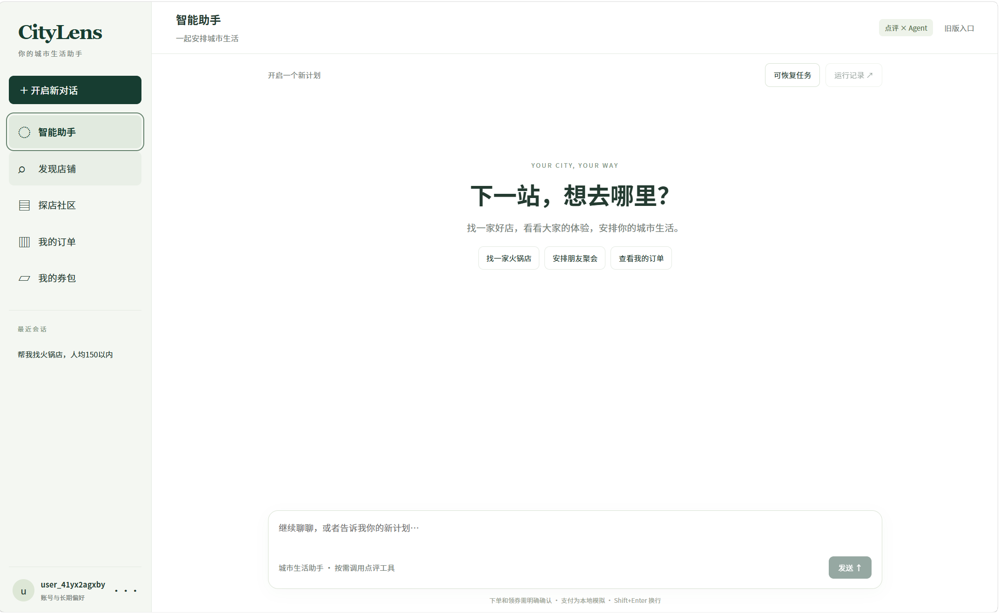
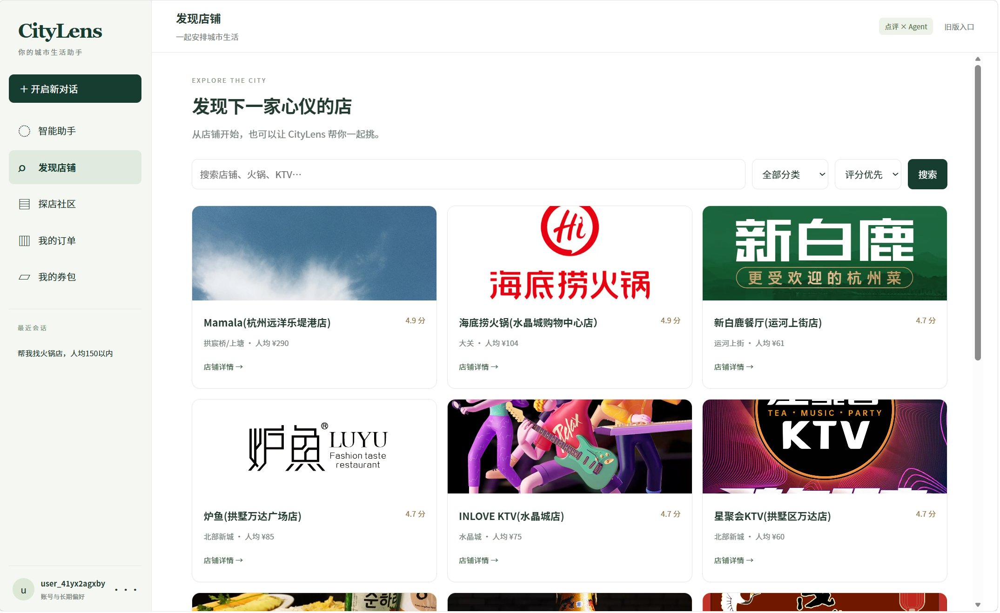
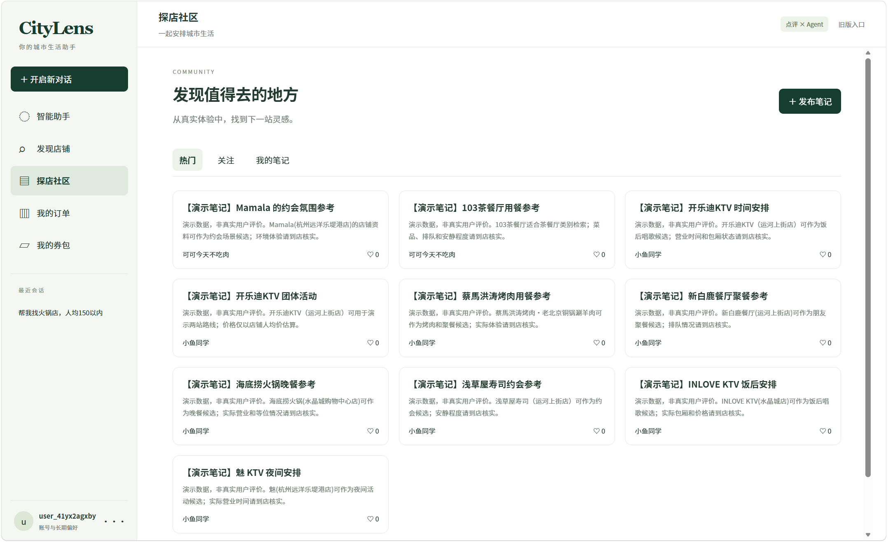
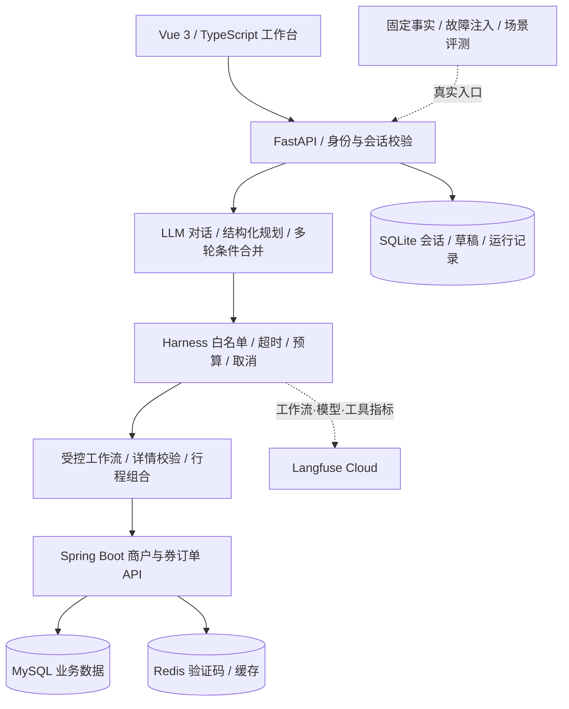

# CityLens · 本地生活 AI Agent

## 在线体验：点开即用

### [打开 CityLens 网站与完整 Demo →](https://citylens-agent-demo.wealthy-liege-0y.chatgpt.site)

无需安装、部署、登录或配置密钥。进入网站后点击 **“开始完整案例”**，依次体验：找店 → 调整预算 → 两站行程 → 查询优惠 → 领券预览 → 明确确认 → 我的订单 / 券包。

网站复用本项目的 Vue 工作台。对话是已验证规则 Agent 案例的交互回放，订单在当前浏览器内模拟；不连接实时大模型，不产生真实交易，刷新页面即重置。可自由浏览合成店铺，并查看原案例运行记录。网站由 Sites 托管，源码保存在本 GitHub 仓库。

## 完整 Agent Demo：5分钟复现

**[开始演示](docs/DEMO.md) · [直接阅读完整执行记录](docs/demo/transcript.md) · [自动验收](https://github.com/jamezhuang/citylens-agent/actions/workflows/agent-demo.yml)**

无需密钥或 Docker，实际执行现有 Agent 和 API：找店 → 多轮调整预算 → 两站规划 → 领券草稿 → 确认 → 重复确认去重 → 查询回执。使用规则 Agent、合成商户及内存订单；不调用模型、不发生真实交易。

```bash
# 克隆仓库后，在 CityLens 目录执行
python -m pip install -r requirements.txt
python demo.py --interactive
```

Windows虚拟环境、macOS/Linux和Codespaces的完整命令见[演示指南](docs/DEMO.md)。已有Vue产品界面的启动说明保留在下方。

用自然语言完成找店、多轮条件调整、多站规划与优惠券确认。

## 界面展示

| 智能助手 | 发现店铺 | 探店社区 |
|---|---|---|
| [](docs/images/assistant.png) | [](docs/images/discover.png) | [](docs/images/community.png) |
| 自然语言需求与多轮调整 | 分类、价格与评分浏览 | 演示笔记、关注与发布入口 |

点击图片可查看原图。

## 业务场景

| 用户需求 | 系统处理 | 业务边界 |
|---|---|---|
| “找人均150以内的火锅” | 解析预算、类别与商圈，查询并核验详情 | 只推荐符合已核验硬条件的候选 |
| “改成三个人，总预算还是400” | 保留上下文，重新计算人数和组合费用 | 人均价是消费参考，不是套餐报价 |
| “先吃饭，再唱歌” | 最多三站的行程组合与排序 | 不提供真实路线或包厢预约 |
| “帮我领第一张券” | 查询在售券、准备草稿、用户确认后提交 | 模型不能跳过确认或擅自支付 |
| 超时、限流或业务拒绝 | 错误分类、有界只读重试、取消与部分结果 | 接口失败不等于没有商户 |

## 技术架构



| 层次 | 技术 | 主要职责 |
|---|---|---|
| 前端 | Vue 3、TypeScript、Pinia、Vite | 对话、店铺、社区、订单与确认窗口 |
| Agent | Python、FastAPI、LLM Tool Calling | 对话交接、规划、工具调用和确定性校验 |
| 业务服务 | Java、Spring Boot、MyBatis-Plus | 商户、券、订单、鉴权与业务操作 |
| 存储 | MySQL、Redis、SQLite | 业务数据、缓存与验证码、会话与草稿 |
| 质量保障 | pytest、ASGI、MockTransport、固定场景 | 单元、接口级集成、故障注入与回归 |
| 观察 | Langfuse SDK / OpenTelemetry | 父子链路、耗时、状态、Token、run_id与源码版本 |

## 代码目录

| 路径 | 内容 |
|---|---|
| `CityLens/citylens/` | Agent、API、工作流、状态管理和观察链路 |
| `CityLens/frontend/` | Vue工作台源码与前端测试 |
| `点评/hm-dianping/` | Java业务服务、初始化表结构与测试 |
| `点评/nginx-1.18.0/html/hmdp/` | 旧点评页面与必要静态资源 |
| `CityLens/evaluation/` | 场景、固定事实、执行器、独立判据与补充审计 |
| `CityLens/dev/` | 本地Docker Compose与演示SQL |

## 本地运行

| 准备项 | 要求 |
|---|---|
| 系统与工具 | Windows PowerShell、Python 3.11+、Node.js 20+、Docker Desktop |
| Java / MySQL / Redis / Nginx | 由Docker Compose启动 |
| 模型 | 不填密钥可运行规则模式；真实模型需本地配置 |

```powershell
git clone https://github.com/jamezhuang/citylens-agent.git
cd citylens-agent/CityLens
python -m venv .venv
.\.venv\Scripts\python.exe -m pip install -r requirements-dev.txt
Copy-Item .env.example .env
Copy-Item frontend/.env.example frontend/.env.local
Push-Location frontend
npm ci
npm run build
Pop-Location
powershell -NoProfile -ExecutionPolicy Bypass -File .\start.ps1
```

| 服务 | 本地地址或端口 |
|---|---|
| CityLens | `http://127.0.0.1:8090` |
| Java API | `127.0.0.1:8081` |
| 图片与旧页面 | `http://127.0.0.1:18080` |
| MySQL / Redis | `127.0.0.1:13306` / `127.0.0.1:6380` |

| 本地 `.env` 配置 | 说明 |
|---|---|
| `CITYLENS_LLM_PROVIDER=deepseek` | 示例模型供应商 |
| `CITYLENS_LLM_MODEL=` | 填账号可用的模型ID |
| `DEEPSEEK_API_KEY=` | 仅在本机填写，不提交Git |
| `LANGFUSE_BASE_URL / PUBLIC_KEY / SECRET_KEY` | 按项目区域填写，见 [接入说明](CityLens/LANGFUSE-SETUP.md) |

登录使用本地演示验证码，不发送真实短信。验证码有效2分钟，可在本机Java调试日志或Redis的 `login:code:<测试手机号>` 查询。

## 测试与评测

```powershell
# CityLens目录
.\.venv\Scripts\python.exe -m pytest tests evaluation/spec_tests -q
Push-Location frontend
npm test
npm run build
Pop-Location
.\.venv\Scripts\python.exe -m evaluation validate
.\.venv\Scripts\python.exe -m evaluation.execution --mode mock_rules --ids S01,D01,P01 --max-cases 3
```

| 验证项目 | 结果或范围 |
|---|---|
| 本次发布源码Python检查 | **232项通过** |
| 同24场景规则对照 | 原6个自动失败项降至0 |
| 修复后规则 / DeepSeek各24场景 | 各14 pass、0 fail、10 needs_review、0 blocked |
| 交易与权限验证 | 模拟业务接口；重复确认、草稿未提交、跨账号拒绝 |
| Cloud观察验证 | 合成链路实际读回4个节点；不代表真实交易验收 |
| 结果限制 | 待审不算通过；单次场景执行不是生产成功率或压测结论 |

| 模式 | 含义 |
|---|---|
| `mock_rules` | 规则Agent + 模拟业务事实 |
| `mock_model` | **真实模型调用** + 模拟业务事实；需显式授权参数与调用预算 |
| 指标 | 状态分布、场景耗时、模型调用数、Token用量、版本与调用账本 |

## 发布范围

| 已包含 | 暂未实现 / 未发布 |
|---|---|
| 稳定版源码、必要资源、测试、演示SQL与文档 | 实验worktree、隔离部署、私有备份和Git旧历史 |
| 结构化用户偏好与会话历史 | 完整RAG、可演化长期记忆、Skills系统 |
| 显式确认和本地模拟支付 | 真实支付、商业券权益和包厢预约 |
| 脱敏指标与源码版本 | 实际.env、数据库、日志、用户上传文件和模型原始轨迹 |
| 演示商户及合成作者 | SQL中的原用户记录与原笔记正文 |

Java点评业务与旧页面基于黑马点评学习项目扩展；保留第三方资源原有声明。Agent、工作台、评测和观察链路为本项目扩展内容。
